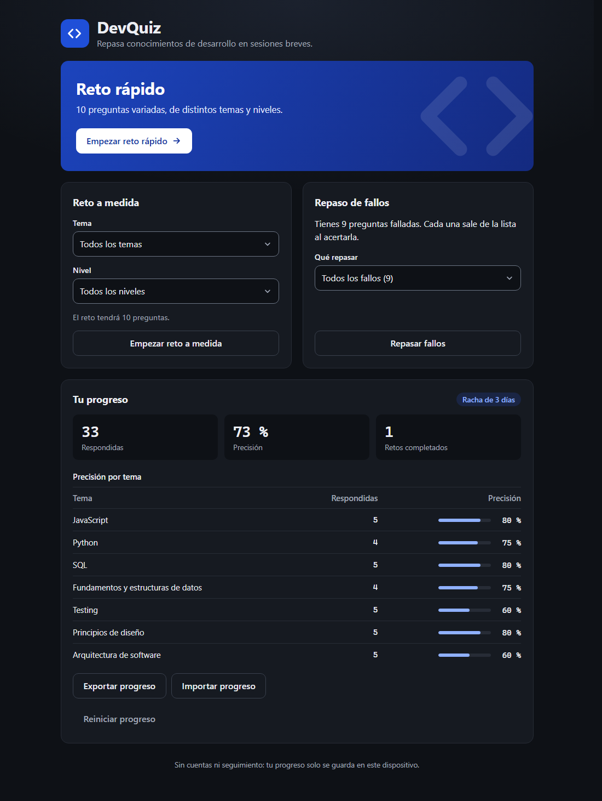
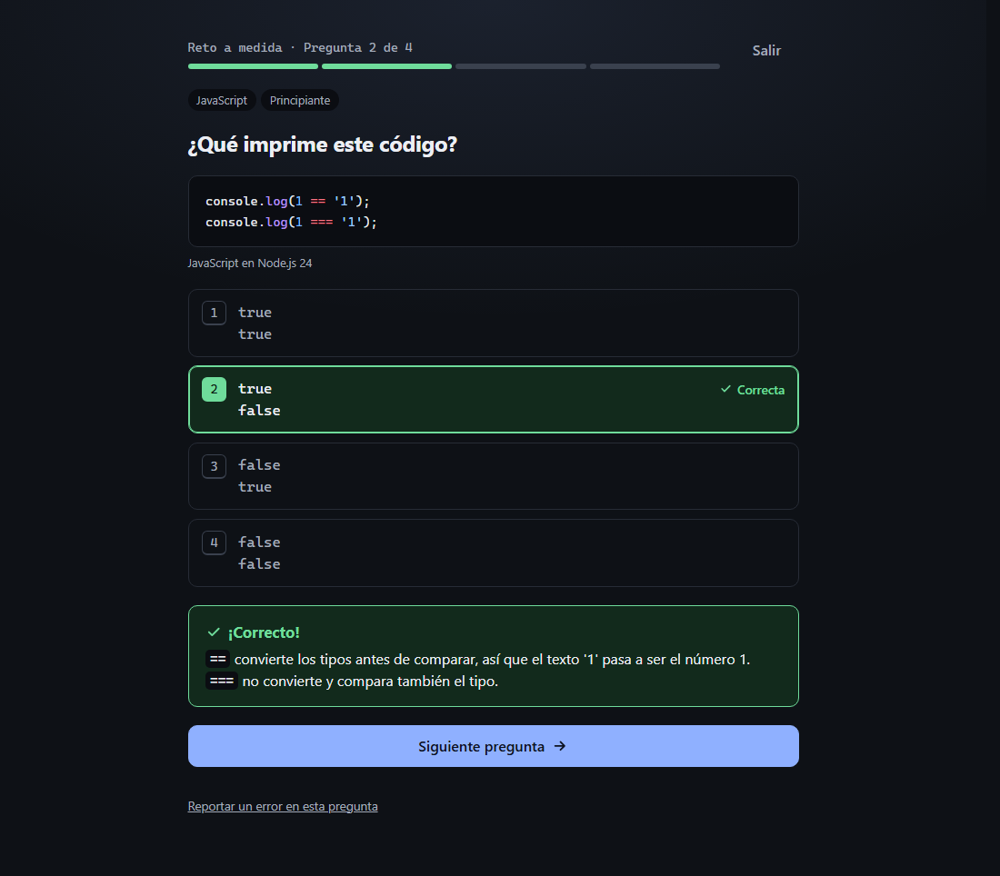
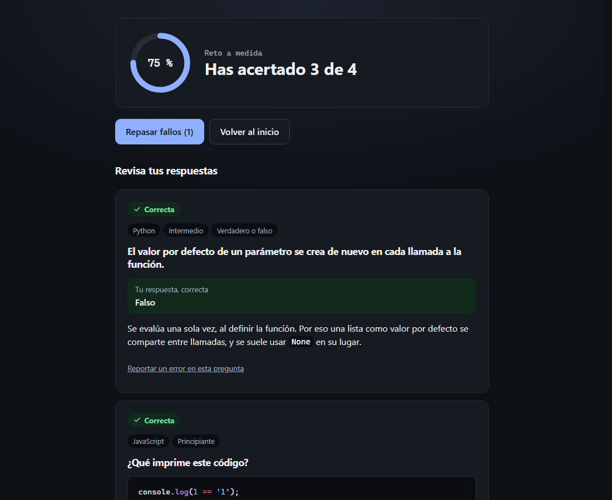

<div align="center">

# `< DevQuiz />`

**Cinco minutos al día para mantener la mente de desarrollador en forma.**

161 preguntas de programación en español, con código real y una explicación en cada respuesta.
Sin cuentas, sin anuncios, sin seguimiento. Funciona sin conexión.

[**Abrir DevQuiz**](https://j3np4y.github.io/devquiz/)

[](https://github.com/J3np4y/devquiz/actions/workflows/ci.yml)



</div>

## Qué lo hace distinto

**El código de las preguntas se ejecuta de verdad.** Cuando una pregunta dice «¿qué imprime este código?», el CI ejecuta el fragmento y comprueba que la respuesta marcada coincide con la salida real. Si no coincide, no se publica.

**Aprendes de cada fallo.** Cada respuesta llega con su explicación, y lo que fallas pasa a una lista de repaso de la que solo sale cuando lo aciertas.

**Vuelve lo que toca, cuando toca.** Las preguntas que dominas se alejan en el tiempo (1, 3, 7, 14, 30 y 60 días), y las que fallas regresan antes.

**Tus datos son tuyos.** El progreso se guarda solo en tu navegador. No hay servidor que lo reciba, y puedes exportarlo a un archivo cuando quieras.

<div align="center">


</div>

## Qué incluye

| | |
|---|---|
| **Reto rápido** | 10 preguntas variadas, de al menos 3 temas y con un mínimo de un 30 % de código |
| **Reto a medida** | Elige tema y nivel |
| **Repaso de fallos** | De todos los temas o de uno solo |
| **Dos formatos** | Opción múltiple y verdadero o falso |
| **Progreso** | Precisión global y por tema, retos completados y racha diaria |
| **Copia de seguridad** | Exporta e importa tu progreso en un archivo JSON |
| **Sin conexión** | Se instala como aplicación y funciona sin red tras la primera visita |
| **Teclado** | `1`-`4` para responder y `Enter` para avanzar |
| **Reanudar** | Si sales a mitad de un reto, sigue donde lo dejaste |

## Temas

JavaScript · Python · SQL · Fundamentos y estructuras de datos · Testing · Principios de diseño · Arquitectura de software

Cada tema tiene tres niveles: principiante, intermedio y avanzado.

## Cómo está hecho

- **React, TypeScript y Vite**, publicado como sitio estático en GitHub Pages.
- **Preguntas en YAML**, validadas con Zod al compilar.
- **Resaltado de código con Shiki al compilar**, para no cargarlo en el navegador.
- **Pruebas con Vitest, Playwright y axe**, en Chromium, Firefox y móvil emulado.
- **Sin recursos de terceros:** ni CDN, ni fuentes externas, ni analítica, con una política de seguridad de contenido que lo hace cumplir.

Si quieres más detalle, están los [requisitos](requirements.md) y el [plan](plan.md).

## Desarrollo

Requiere Node 24 o superior.

```bash
npm install
```

```bash
npm run dev
```

Antes de subir cambios, ejecuta lint, tipos, tests y build:

```bash
npm run check
```

Las pruebas E2E se ejecutan contra la compilación de producción e incluyen axe. Usan Chromium, y además Firefox en CI. La primera vez hay que instalar el navegador con `npx playwright install chromium`:

```bash
npm run test:e2e
```

El despliegue a GitHub Pages es automático al subir a `main`.

## Añadir preguntas

Las preguntas están en `content/questions/`, en un archivo YAML por tema. El formato se describe en el [plan](plan.md). Para validarlas y ejecutar los fragmentos verificables (requiere Python):

```bash
npm run content:check
```

¿Has visto una pregunta con un error? Cada una tiene un enlace para reportarlo.
